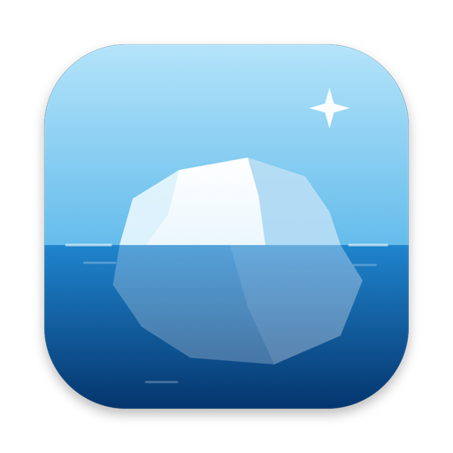
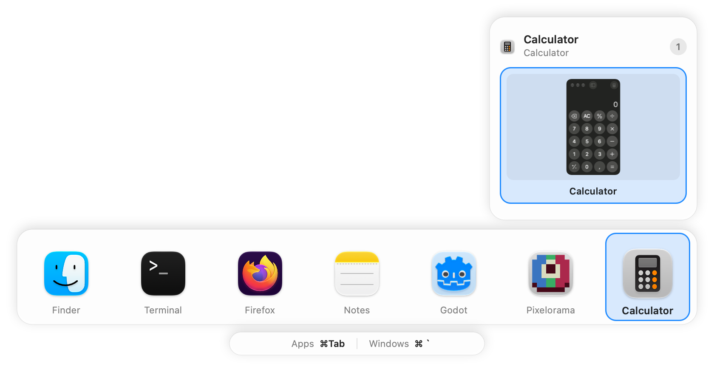
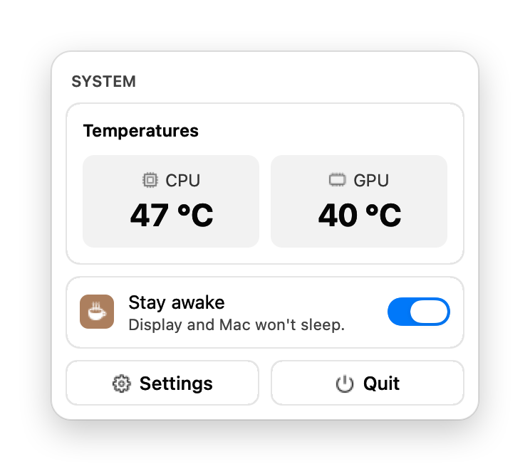
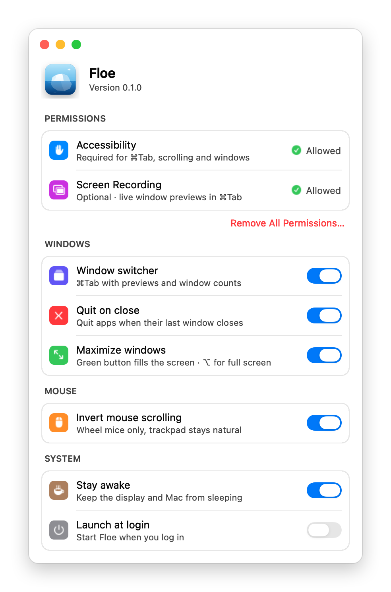

<p align="center">
  
</p>

<h1 align="center">Floe</h1>

<p align="center">
  <b>A tiny macOS menu bar app that does six things, and does them fast.</b><br>
  ⌘Tab with previews · quit on close · green-button maximize · mouse scroll fix · stay awake · CPU/GPU temps
</p>

<p align="center">
  
  
  
  
  
</p>

<p align="center">
  
</p>

## Why Floe

All-in-one Mac utilities keep growing until the few features you rely on get slow or flaky: ⌘Tab that sometimes doesn't fire, a menu bar popup that closes as soon as it opens. Floe keeps only six of those features and makes each one dependable:

- **Window switcher.** ⌘Tab shows your apps as large icons, with a floating card of live previews for the selected app's windows on every Space. ⌘\` moves between windows, W closes one, Q quits the app, Esc cancels. Tabs (Terminal, Finder) count as one window. Apps with no open windows, like Finder after you close it, stay out of the way.
- **Quit on close.** Closing an app's last window quits it, the way it works on Windows. Finder and menu bar apps are left alone.
- **Maximize windows.** The green button fills the screen instead of opening a new full-screen Space. Click again to restore, or ⌥-click for real full screen.
- **Invert mouse scrolling.** Flips wheel mice (hello, Logitech) while the trackpad keeps natural scrolling.
- **Stay awake.** Keeps the display and the Mac awake, one switch in the menu bar.
- **CPU and GPU temperatures** in the menu bar panel, read straight from the SMC.

<p align="center">
  
  &nbsp;&nbsp;
  
</p>

## Light by design

| | **Floe 0.1** | Vorssaint 3.4 |
|---|---|---|
| App size | **0.9 MB** | 85 MB |
| Executable | **0.4 MB** | 81 MB |
| Memory after launch | **17 MB** | 21 MB |
| Features | 6 | 79 |

<sub>Measured on an M4 running macOS 27.2: physical footprint from `footprint` about 20 seconds after launch. Vorssaint does a lot more than Floe; this table is about what it costs when these six things are all you use.</sub>

What keeps it light and quick:

- **No dependencies, nothing bundled:** about 1,400 lines of Swift compiled into one binary with `swiftc`.
- **No background work.** Temperatures are only read while the panel is open, and window previews are only captured for the app you land on in ⌘Tab, then released. The only timer runs while Floe waits for you to grant a permission.
- **Input never waits on the UI.** Keyboard and scroll handling run on their own thread, so a busy app or a slow window capture can't make ⌘Tab or scrolling stutter. If macOS ever pauses the event tap, Floe turns it back on immediately.
- **A hung app can't freeze Floe.** Every Accessibility call has a 250 ms timeout.
- **The menu bar panel is reliable:** it opens on mouse-down and closes only on an outside click, Esc or the icon, never on its own.

## Install

Floe builds from source in a few seconds. You need macOS 14 or later on Apple Silicon and Apple's command line tools:

```sh
xcode-select --install   # skip if you already have them
```

Then:

```sh
git clone https://github.com/CyberIce2077/floe.git
cd floe
make cert      # once: creates a local signing identity so macOS remembers Floe's permissions
make install   # builds Floe, copies it to /Applications and opens it
```

### Permissions

On first launch Floe opens Settings and lists exactly what it needs, each with an **Allow** button:

| Permission | Needed for |
|---|---|
| **Accessibility** | ⌘Tab, mouse scrolling, maximize and quit on close |
| **Screen Recording** *(optional)* | live window previews in ⌘Tab. Without it you still get icons and window counts. |

Each row switches to *Allowed* as soon as you grant it. **Remove All Permissions…** in Settings revokes both and quits Floe.

### Update

```sh
git pull && make install
```

Your permissions carry over between builds thanks to `make cert`.

### Uninstall

1. Settings → **Remove All Permissions…**
2. Then:

```sh
rm -rf /Applications/Floe.app
defaults delete io.github.cyberice2077.floe
security delete-keychain ~/Library/Keychains/floe-signing.keychain-db
```

## Keys

| In ⌘Tab | |
|---|---|
| ⌘Tab / ⌘⇧Tab | next / previous app |
| ⌘\` / ⌘⇧\` | next / previous window of that app |
| ← → | move between apps |
| W | close the selected window |
| Q | quit the selected app |
| Esc | cancel |
| release ⌘ | switch |

A quick ⌘Tab tap switches straight to the last app without showing the panel.

## License

[MIT](LICENSE)
