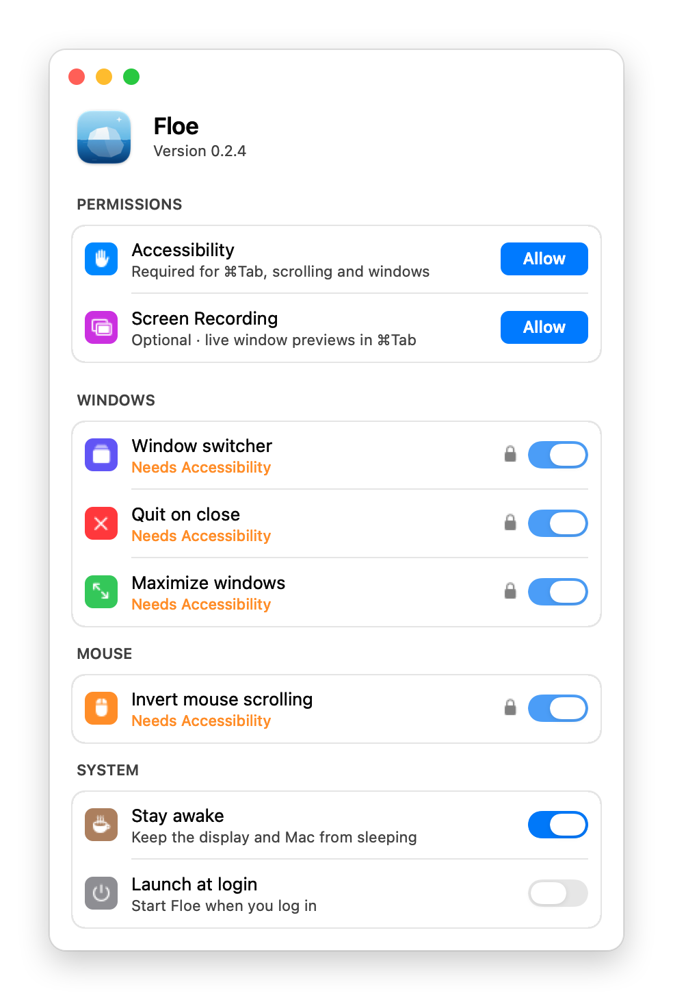

<p align="center">
  
</p>

<h1 align="center">Floe</h1>

<p align="center">
  <b>A tiny macOS menu bar app that does six things, and does them fast.</b><br>
  ⌘Tab with previews · quit on close · green-button maximize · mouse scroll fix · stay awake · system stats
</p>

<p align="center">
  
  
  
  
  
</p>

<p align="center">
  
</p>

## Why Floe

All-in-one Mac utilities keep growing until the few features you rely on get slow or flaky: ⌘Tab that sometimes doesn't fire, a menu bar popup that closes as soon as it opens. Floe keeps only six of those features and makes each one dependable:

- **Window switcher.** ⌘Tab shows your apps as large icons, with a floating card of live previews for the selected app's windows on every Space. ⌘\` moves between windows, W closes one, Q quits the app, Esc cancels. Tabs (Terminal, Finder) count as one window. Apps with no open windows, like Finder after you close it, stay out of the way.
- **Quit on close.** Closing an app's last window quits it, the way it works on Windows. Finder and menu bar apps are left alone.
- **Maximize windows.** The green button fills the screen instead of opening a new full-screen Space. Click again to restore, or ⌥-click for real full screen.
- **Invert mouse scrolling.** Flips wheel mice (hello, Logitech) while the trackpad keeps natural scrolling.
- **Stay awake.** Keeps the display and the Mac awake, one switch in the menu bar. While it's on, a small blue glint twinkles into the menu bar icon.
- **System stats** in the menu bar panel: CPU and GPU temperature and usage, memory (app, wired, compressed, cached, swap and pressure), free SSD space and network speed. Temperatures come straight from the SMC, the rest from the kernel and the GPU driver.

<p align="center">
  
  &nbsp;&nbsp;
  
</p>

## Light by design

| | **Floe 0.2.4** | Vorssaint 3.4 |
|---|---|---|
| App size | **0.9 MB** | 85 MB |
| Executable | **0.4 MB** | 81 MB |
| Memory after launch | **18 MB** | 21 MB |
| Features | 6 | 79 |

<sub>Measured on an M4 running macOS 27.2: physical footprint from `footprint` about 20 seconds after launch. Vorssaint does a lot more than Floe; this table is about what it costs when these six things are all you use.</sub>

What keeps it light and quick:

- **No dependencies, nothing bundled:** about 1,800 lines of Swift compiled into one binary with `swiftc`.
- **No background work.** System stats are only read while the panel is open, and window previews are only captured for the app you land on in ⌘Tab, then released. The only timer runs while Floe waits for you to grant a permission.
- **Input never waits on the UI.** Keyboard and scroll handling run on their own thread, so a busy app or a slow window capture can't make ⌘Tab or scrolling stutter. If macOS ever pauses the event tap, Floe turns it back on immediately.
- **A hung app can't freeze Floe.** Every Accessibility call has a 250 ms timeout.
- **The menu bar panel is reliable:** it opens on mouse-down and closes only on an outside click, Esc, the icon or another menu bar item, never on its own. On macOS 27 it takes part in the menu bar like a real menu, highlight included.

## Install

With [Homebrew](https://brew.sh), on macOS 14 or later with Apple Silicon:

```sh
brew install --cask cyberice2077/floe/floe
```

Then open Floe from Applications. Floe is signed but not notarized (that takes a paid Apple developer account), so the cask clears the download's quarantine flag for you; otherwise macOS would refuse to open it.

<details>
<summary><b>Build from source instead</b></summary>

You need Apple's command line tools (`xcode-select --install`). Then:

```sh
git clone https://github.com/CyberIce2077/floe.git
cd floe
make cert      # once: creates a local signing identity so macOS remembers Floe's permissions
make install   # builds Floe, copies it to /Applications and opens it
```

To update, `git pull && make install`.

</details>

### Permissions

On first launch Floe opens Settings and lists exactly what it needs, each with an **Allow** button:

| Permission | Needed for |
|---|---|
| **Accessibility** | ⌘Tab, mouse scrolling, maximize and quit on close |
| **Screen Recording** *(optional)* | live window previews in ⌘Tab. Without it you still get icons and window counts. |

Each row switches to *Allowed* as soon as you grant it. Until Accessibility is allowed, the features that need it are locked: their switches keep your choice but stay dimmed, with a lock you can click to allow it, and they unlock the moment you do.

<p align="center">
  
</p>

**Remove All Permissions…** in Settings revokes both and quits Floe.

### Update

```sh
brew outdated floe   # is there a newer Floe?
brew upgrade floe    # update Floe only, nothing else
```

Every release is signed with the same identity, so macOS keeps Floe's permissions across updates.

### Uninstall

1. Settings → **Remove All Permissions…**
2. Then:

```sh
brew uninstall --zap floe
```

If you built from source, remove it with `rm -rf /Applications/Floe.app`, `defaults delete io.github.cyberice2077.floe` and `security delete-keychain ~/Library/Keychains/floe-signing.keychain-db`.

## Keys

| In ⌘Tab | |
|---|---|
| ⌘Tab / ⌘⇧Tab | next / previous app |
| ⌘\` / ⌘⇧\` | next / previous window of that app |
| ← → | move between apps |
| W | close the selected window |
| Q | quit the selected app |
| Esc | cancel |
| release ⌘ | switch |

A quick ⌘Tab tap switches straight to the last app without showing the panel.

## License

[MIT](LICENSE)
